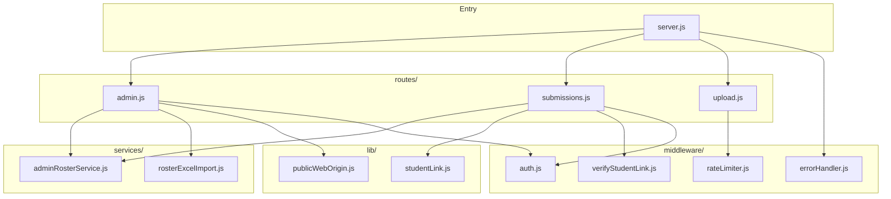

# Backend (`server/`) — overview & file connections

## What this folder is

The **Technathon JSON API**: Express app in **`server.js`**, MongoDB (or in-memory in tests) for **submissions** and **roster**, signed student links, admin JWT auth, AWS S3 uploads.

## High-level architecture

## Route prefixes (mounted in `server.js`)

| Mount path | File | Purpose |
|------------|------|---------|
| `/api/admin` | `routes/admin.js` | Login, roster import, student links, roster GET |
| `/api/submissions` | `routes/submissions.js` | By-link GET/PUT, admin list, Excel export |
| `/api/upload` | `routes/upload.js` | Video/document multipart → AWS S3 |

## Source files → connections

| File | Role | Connects to |
|------|------|-------------|
| `server.js` | App bootstrap, Mongoose models, `init()` routers | All routes, `adminRosterService.configure` |
| `routes/admin.js` | Admin auth + roster + links | `adminRosterService`, `rosterExcelImport`, `publicWebOrigin`, `bcrypt`, `jwt` |
| `routes/submissions.js` | Submissions + roster merge on by-link | `Submission` / `RosterStudent` via `init`, `verifyStudentLink`, `studentLink` |
| `routes/upload.js` | Multer + AWS S3 SDK | Rate limiter |
| `services/adminRosterService.js` | Roster upsert, link mint/persist, `buildRoster` | `studentLink` lib |
| `services/rosterExcelImport.js` | Parse `.xlsx` row 1 headers | Used only by `admin.js` |
| `middleware/auth.js` | JWT `requireAuth` | Used by admin + protected submission routes |
| `middleware/verifyStudentLink.js` | HMAC + expiry on by-link routes | `lib/studentLink.js` |
| `middleware/rateLimiter.js` | express-rate-limit presets | `admin.js`, `upload.js` |
| `middleware/errorHandler.js` | Central JSON errors | `server.js` last middleware |
| `lib/studentLink.js` | Sign/verify URLs | `verifyStudentLink`, `adminRosterService`, tests |
| `lib/publicWebOrigin.js` | Base URL for share links | `admin.js` |

## Related docs

- [Per-file notes (server + index)](../../docs/file-notes/README.md)
- [Server notes folder](../../docs/file-notes/server/)
