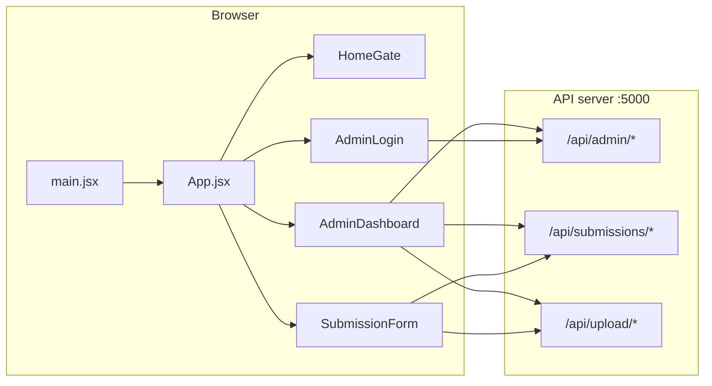

# Frontend (`client/`) — overview & file connections

## What this folder is

The **student and admin web app** built with **Vite + React**. It talks to the **Express API** in `server/` using `fetch` and the base URLs from `src/apiConfig.js`.

## How it connects to the backend

| Frontend area | HTTP base | Backend routes (examples) |
|---------------|-----------|-----------------------------|
| JSON (roster, links, submissions list) | `API_BASE` — empty in dev (same origin → Vite **proxy** `/api`) | `/api/admin/*`, `/api/submissions` |
| Multipart uploads (video/PDF) | `UPLOAD_API_BASE` — usually **direct** `http://127.0.0.1:5000` in dev | `/api/upload/video`, `/api/upload/document` |
| Student form load/save | `API_BASE` + path from signed link | `GET/PUT /api/submissions/by-link/...` |

Configure production API URL via **`VITE_API_URL`** at build time (see `apiConfig.js`).

## Request flow (diagram)

## Source files → what they connect to

| File | Role | Imports / uses |
|------|------|------------------|
| `src/main.jsx` | React entry: mounts `<App />` | `App.jsx`, `index.css`, Toastify CSS |
| `src/App.jsx` | Router, layout, background, routes | `HomeGate`, `SubmissionForm`, `AdminLogin`, `AdminDashboard`, `react-router-dom`, `ToastContainer` |
| `src/apiConfig.js` | `API_BASE`, `UPLOAD_API_BASE` for all `fetch` | Used by `SubmissionForm`, `AdminDashboard`, `AdminLogin` |
| `src/utils/toastNotify.js` | Toast helpers | Used by forms and admin |
| `src/components/HomeGate.jsx` | Landing when no signed URL | `react-router-dom` Link only |
| `src/components/SubmissionForm.jsx` | Signed URL form: `GET/PUT` by-link | `apiConfig`, `toastNotify`, route params `studentId/exp/sig` |
| `src/components/AdminLogin.jsx` | `POST /api/admin/login`, stores JWT | `apiConfig`, `toastNotify`, `localStorage` |
| `src/components/AdminDashboard.jsx` | Roster, import, links, export | `apiConfig`, `authFetch` pattern, many admin + roster endpoints |

## Related docs

- [Per-file notes (client + index)](../docs/file-notes/README.md)
- [Client notes folder](../docs/file-notes/client/src/)
